<!-- Generated by scripts/build.mjs. Edit config.mjs instead. -->
<picture>
  <source media="(max-width: 600px)" srcset="assets/terminal-narrow.svg">
  <source media="(max-width: 1100px)" srcset="assets/terminal-mid.svg">
  
</picture>

### ~/work

**[Flexiestays](https://flexiestays.com)** · Serviced apartments in Bournemouth, UK. I lead development: the Nuxt website, the Flutter app, the internal dashboards, and Foxie, the AI agent guests talk to, built on the Vercel AI SDK.

**Aisbar** · A shift-handover tool for ICU doctors in Brazil. In development, closed source for now.

Laravel · Nuxt · Next.js · React · Flutter · Python

### ~/repos

- **[flexiestays-info](https://github.com/ArthurPedreca/flexiestays-info)** · The Bournemouth Guide: an SEO-first static site in Astro whose pages an automation pipeline can write.
- **[cp-forzy-governan-a](https://github.com/ArthurPedreca/cp-forzy-governan-a)** · A FastAPI sensor API that logs every call for observability, with a Streamlit client. Built with a FIAP team.
- **[desafio_crewAI](https://github.com/ArthurPedreca/desafio_crewAI)** · A multi-agent editorial assistant on CrewAI.
- **[ArthurPedreca](https://github.com/ArthurPedreca/ArthurPedreca)** · This page. A cron redraws it from my contribution calendar every six hours.

 

[Portfolio](https://arthurpedreca.github.io/Portfolio/) · Freelance projects through [Upwork](https://www.upwork.com/freelancers/~01f52910ffb0d32b70)
