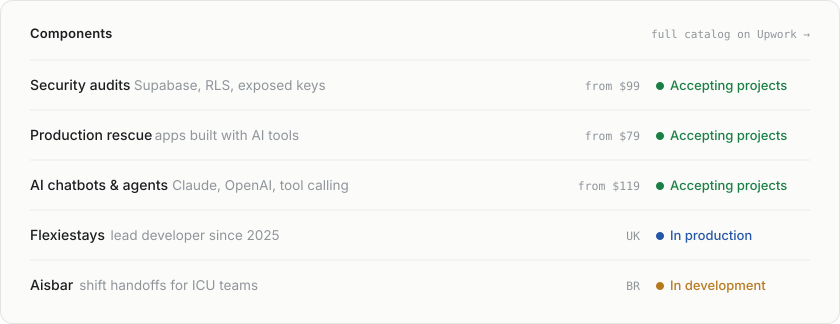
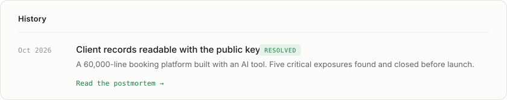
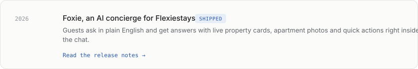

<!-- Generated by scripts/build.mjs. Edit config.mjs instead. -->
<a href="https://arthurpedreca.github.io/Portfolio/"><picture><source media="(prefers-color-scheme: dark)" srcset="assets/status-dark.svg"></picture></a>

<a href="https://www.upwork.com/freelancers/~01f52910ffb0d32b70"><picture><source media="(prefers-color-scheme: dark)" srcset="assets/services-dark.svg"></picture></a>

<a href="https://arthurpedreca.github.io/Portfolio/history/open-database.html"><picture><source media="(prefers-color-scheme: dark)" srcset="assets/incident-open-database-dark.svg"></picture></a>

<a href="https://arthurpedreca.github.io/Portfolio/history/foxie.html"><picture><source media="(prefers-color-scheme: dark)" srcset="assets/incident-foxie-dark.svg"></picture></a>

  <a href="https://arthurpedreca.github.io/Portfolio/">Portfolio</a> &nbsp;·&nbsp;
  <a href="https://arthurpedreca.github.io/Portfolio/#history">History</a> &nbsp;·&nbsp;
  <a href="https://www.upwork.com/freelancers/~01f52910ffb0d32b70">Hire me on Upwork</a>

How this page works

 

A GitHub Action reads my public contribution calendar every six hours and redraws these cards as SVG (light and dark), with fonts and animations inside the file. Nothing is hosted elsewhere. The banner flips to amber when I set <code>available: false</code> in <code>config.mjs</code>. Last run: 30 Oct 2026, 13:39 (São Paulo).

