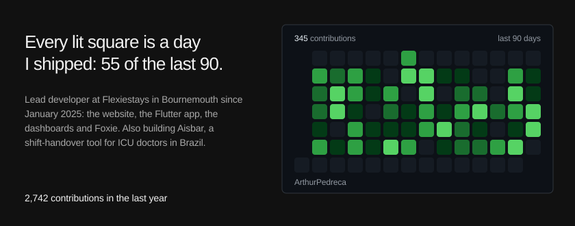
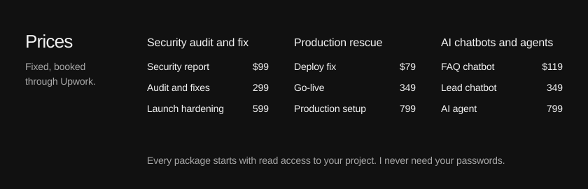

<!-- Generated by scripts/build.mjs. Edit config.mjs instead. -->

  <a href="https://arthurpedreca.github.io/Portfolio/">Portfolio</a> &nbsp;·&nbsp;
  <a href="https://arthurpedreca.github.io/Portfolio/history/open-database.html">The audit</a> &nbsp;·&nbsp;
  <a href="https://arthurpedreca.github.io/Portfolio/history/foxie.html">Foxie</a> &nbsp;·&nbsp;
  <a href="https://www.upwork.com/freelancers/~01f52910ffb0d32b70">Hire me on Upwork</a>

